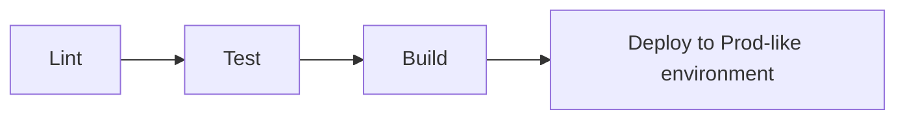
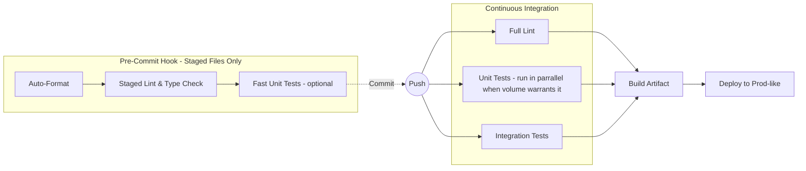
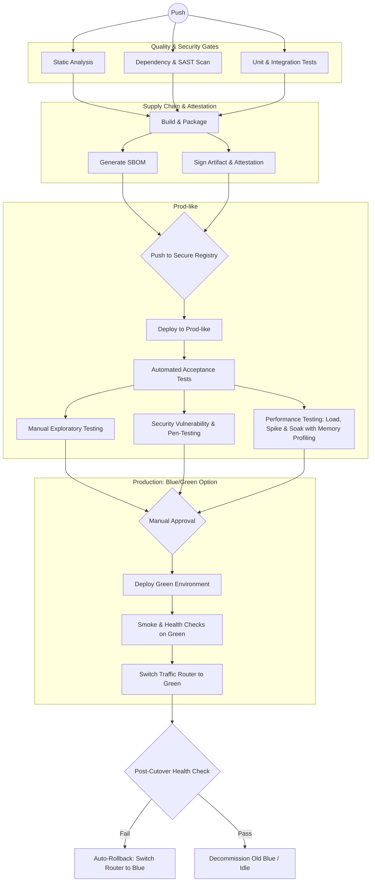
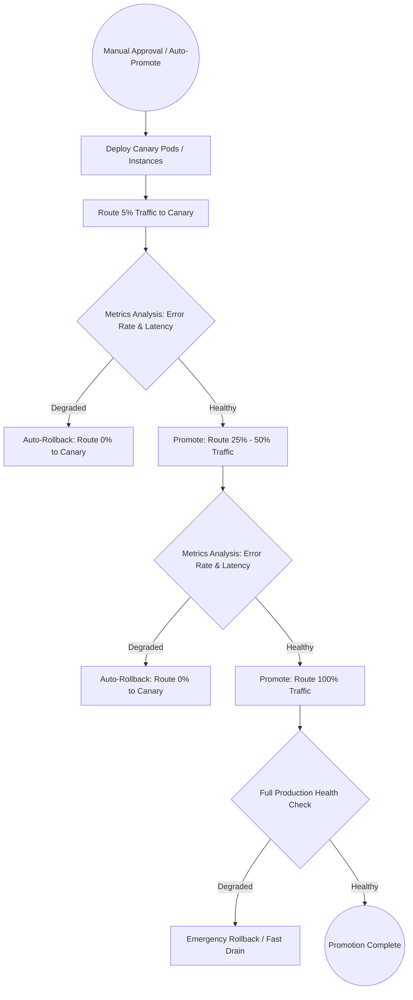

# CI/CD Examples

This repository contains conceptual and implementation examples of CI/CD deployment pipelines.

## Conceptual Pipeline Levels

These examples are provider-agnostic and focus on the workflow structure.

### 1. Basic (Sequential)
A simple linear pipeline suitable for small projects or early-stage development. Each step must succeed before the next begins. 
These ideally are running on CI/CD infra so there is no dependence on a single workstation to deploy changes. 

### 2. Medium (Parallel Testing & Pre-Commit Hygiene)
Introduces local pre-commit guardrails alongside parallel CI execution. The pre-commit phase targets only modified files to keep feedback instantaneous (auto-formatting, staged linting, type checks, and rapid unit tests).

### 2.5 Medium+ (PR Automation & Review Bots)
Builds upon the Medium workflow by integrating automated PR review tooling. Triggers on pull requests to provide early feedback directly in review threads prior to merging.

### 3. Advanced (Enterprise Workflow & Supply Chain Security)
Features complex orchestration including supply chain attack prevention (dependency pinning, vulnerability scanning, provenance attestation), optional SBOM (Software Bill of Materials) artifact generation and signing, environment promotions, and automated rollbacks or manual approvals. Once automated acceptance tests pass in a prod-like environment, parallel post-deployment verification runs: manual exploratory testing, security vulnerability/penetration testing, and performance testing (load, spike, and soak with memory profiling).

#### Production Promotion Strategies

Depending on risk tolerance, architecture, and traffic profile, teams typically choose between Blue/Green cutover or progressive Canary promotions:

##### Strategy A: Blue/Green Deployment
- Spins up an identical target environment (Green) running the new version.
- Validates the deployment in isolation.
- Switches router/load balancer traffic instantly from Blue to Green.
- Rapid rollbacks are accomplished by instantly repointing the router back to Blue.

##### Strategy B: Canary Deployment (Progressive Delivery)
- Deploys the new revision alongside the current version to a small subset of infrastructure.
- Incrementally routes real traffic (e.g., 5% &rarr; 25% &rarr; 100%) while automated metric analysis (error rates, latency, APM telemetry) validates system health at each step.
- Automatically halts and rolls traffic back to 0% if error or latency thresholds are exceeded.

## Provider Specific Implementations

*Links coming soon for:*
- GitHub Actions (GHA)
- Jenkins
- GitLab CI/CD
- ArgoCD
