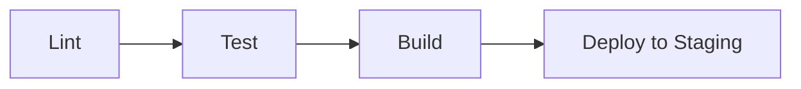
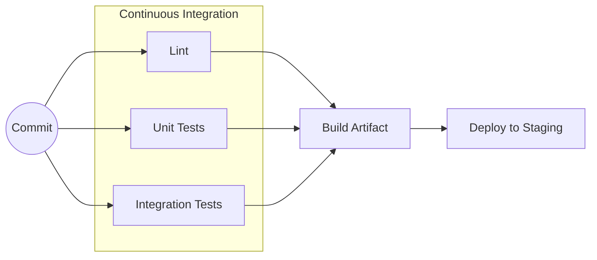
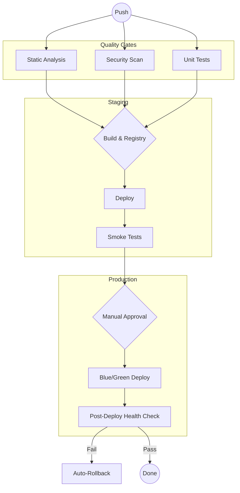

# CI/CD Examples

This repository contains conceptual and implementation examples of CI/CD deployment pipelines.

## Conceptual Pipeline Levels

These examples are provider-agnostic and focus on the workflow structure.

### 1. Basic (Sequential)
A simple linear pipeline suitable for small projects or early-stage development. Each step must succeed before the next begins.

### 2. Medium (Parallel Testing)
Introduces parallelism to speed up the feedback loop. Tests and linting run concurrently.

### 3. Advanced (Enterprise Workflow)
Features complex orchestration including security scanning, environment promotions, and automated rollbacks or manual approvals.

## Provider Specific Implementations

*Links coming soon for:*
- GitHub Actions (GHA)
- Jenkins
- GitLab CI/CD
- ArgoCD
